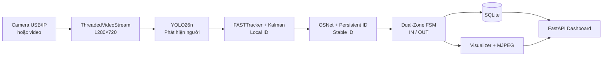
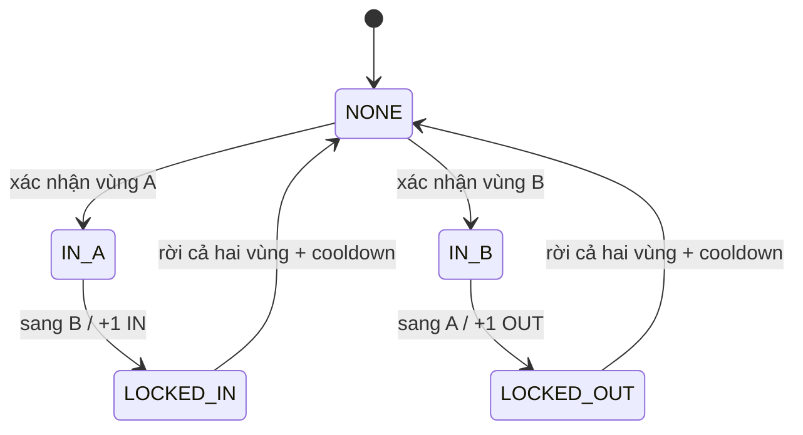

# KỊCH BẢN BẢO VỆ ĐỒ ÁN SMARTGATE AI

## Hệ thống nhận diện, bám vết và đếm người ra/vào theo thời gian thực

> Tài liệu này là kịch bản chuẩn bị nội dung cho bài bảo vệ khoảng **10–15 phút**, gồm **7 phần lớn và 13 slide**. Mỗi slide có nội dung trình chiếu, lời thuyết trình, gợi ý hình minh họa và câu chuyển sang slide tiếp theo.

---

## 1. Mục tiêu của bài thuyết trình

Sau bài trình bày, hội đồng cần hiểu được bốn điểm chính:

1. SmartGate AI giải quyết bài toán thực tế nào và vì sao bài toán đó khó.
2. Hệ thống được thiết kế theo kiến trúc nào và vì sao cần kết hợp nhiều thuật toán.
3. Sản phẩm đã được triển khai đến mức nào, có những chức năng gì và hoạt động ra sao.
4. Kết quả kiểm thử hiện tại chứng minh được điều gì, chưa chứng minh được điều gì và hướng phát triển tiếp theo là gì.

---

## 2. Bố cục 7 phần

| Phần | Nội dung | Slide | Thời lượng gợi ý |
|---|---|---:|---:|
| 1 | Mở đầu và đặt vấn đề | 1–2 | 1 phút 20 giây |
| 2 | Mục tiêu, phạm vi và yêu cầu | 3 | 50 giây |
| 3 | Phân tích và thiết kế giải pháp | 4–5 | 2 phút |
| 4 | Thuật toán và thành phần cốt lõi | 6–8 | 3 phút 30 giây |
| 5 | Xây dựng hệ thống hoàn chỉnh | 9–10 | 1 phút 50 giây |
| 6 | Kết quả, demo và đánh giá | 11–12 | 2 phút 40 giây |
| 7 | Hạn chế, roadmap, kết luận và Q&A | 13 | 1 phút |
| | **Tổng cộng** | **13 slide** | **Khoảng 13 phút** |

---

# PHẦN 1 — MỞ ĐẦU VÀ ĐẶT VẤN ĐỀ

## Slide 1 — Giới thiệu đề tài

### Tiêu đề trên slide

**SMARTGATE AI**  
**Hệ thống nhận diện, bám vết và đếm người ra/vào theo thời gian thực**

### Nội dung hiển thị

- Ứng dụng Computer Vision và Edge AI.
- Phát hiện, bám vết và đếm lưu lượng người hai chiều.
- Hoạt động với camera USB, camera IP và video có sẵn.
- Công nghệ chính: YOLO26n, FASTTracker, Kalman Filter, OSNet, FastAPI và SQLite.

Phần cuối slide để thông tin:

- Sinh viên thực hiện: `[Họ và tên]`
- Mã sinh viên: `[Mã sinh viên]`
- Giảng viên hướng dẫn: `[Tên giảng viên]`
- Lớp/Khoa: `[Thông tin lớp và khoa]`

### Lời thuyết trình

> Kính thưa thầy cô và hội đồng, đề tài em thực hiện là SmartGate AI — hệ thống nhận diện, bám vết và đếm người ra vào theo thời gian thực. Hệ thống hướng đến các khu vực có nhiều người qua lại như khu du lịch, cổng ra vào, khu vui chơi, trung tâm thương mại hoặc khu vực công cộng. Điểm khác biệt của đề tài không chỉ là phát hiện người trong từng hình ảnh mà còn theo dõi hành trình, giữ ID và chỉ đếm khi một người thực sự di chuyển từ vùng này sang vùng kia.

### Gợi ý hình minh họa

- Ảnh giao diện SmartGate AI đang hiển thị bounding box, hai vùng ROI và bộ đếm IN/OUT.
- Không nên đưa quá nhiều chữ hoặc sơ đồ vào slide mở đầu.

### Câu chuyển slide

> Trước khi trình bày giải pháp, em xin bắt đầu từ vấn đề thực tế mà hệ thống cần giải quyết.

---

## Slide 2 — Bối cảnh và bài toán thực tế

### Tiêu đề trên slide

**Vì sao đếm người bằng camera là một bài toán khó?**

### Nội dung hiển thị

- Người đi sát nhau hoặc che khuất lẫn nhau.
- Người chạy nhanh làm mất bounding box và đổi ID.
- Người đứng gần cửa, quay đầu hoặc đi sát ranh giới dễ gây đếm lặp.
- Camera đặt góc chéo làm quỹ đạo trên ảnh không đơn giản.
- Bóng cây, mưa, thiếu sáng, ngược sáng và cháy sáng làm giảm chất lượng ảnh.
- FPS camera và FPS AI không luôn bằng nhau.

Đặt câu hỏi trung tâm ở cuối slide:

> Làm thế nào để biết **đó vẫn là cùng một người** và chỉ đếm khi người đó hoàn thành đúng hành trình?

### Lời thuyết trình

> Nếu chỉ sử dụng một mô hình phát hiện trên từng frame, hệ thống chỉ biết trong ảnh hiện tại có người nhưng không biết người đó là ai trong chuỗi thời gian. Khi một người bị che khuất, Local ID có thể mất. Khi xuất hiện lại, tracker có thể tạo ID mới và làm đứt hành trình. Ngoài ra, phương pháp đếm bằng một đường thẳng đơn giản dễ đếm sai khi người đứng lưỡng lự, quay đầu hoặc bounding box rung ngay gần cửa. Vì vậy bài toán cần giải quyết đồng thời phát hiện, tracking, nhớ ID và logic đếm chống lặp.

### Gợi ý hình minh họa

Chia slide thành bốn hình nhỏ:

1. Người bị che bởi người khác.
2. Người đi nhanh hoặc chỉ xuất hiện một phần.
3. Cảnh ngược sáng/cháy sáng.
4. Hai người mặc trang phục gần giống nhau.

### Câu chuyển slide

> Từ các vấn đề trên, em xác định mục tiêu và phạm vi cụ thể của hệ thống như sau.

---

# PHẦN 2 — MỤC TIÊU, PHẠM VI VÀ YÊU CẦU HỆ THỐNG

## Slide 3 — Mục tiêu và phạm vi

### Tiêu đề trên slide

**Hệ thống cần làm được gì?**

### Nội dung hiển thị

#### Mục tiêu chức năng

- Phát hiện lớp `person` trong hình ảnh.
- Bám vết nhiều người và duy trì ID theo thời gian.
- Khôi phục Stable ID sau che khuất hoặc mất dấu.
- Xác định hướng `A → B = IN`, `B → A = OUT`.
- Tính `Occupancy = max(0, IN - OUT)`.
- Lưu sự kiện, hiển thị dashboard, biểu đồ và xuất báo cáo Excel.
- Cho phép cấu hình ROI trực tiếp trên giao diện.

#### Yêu cầu phi chức năng

- Hoạt động realtime, không để hàng đợi frame gây trễ tăng dần.
- Chạy offline/on-premise, không phụ thuộc Cloud API.
- Hỗ trợ CUDA GPU và có khả năng chuyển sang CPU khi cần.
- Tách xử lý AI khỏi render/JPEG để giảm ảnh hưởng đến FPS.

#### Phạm vi không thực hiện

- Không nhận diện khuôn mặt hoặc danh tính thật.
- Không xác định tuổi và giới tính trong pipeline hiện tại.
- Không dùng Stable ID như bằng chứng xác định danh tính cá nhân.

### Lời thuyết trình

> Mục tiêu của SmartGate AI là theo dõi đối tượng ẩn danh bằng Stable ID, không nhận diện khuôn mặt và không xác định danh tính thật. Hệ thống chỉ cần biết một người trong chuỗi video có khả năng là cùng đối tượng trước đó để hoàn thành hành trình đếm. Toàn bộ AI chạy cục bộ, phù hợp với yêu cầu riêng tư và không phụ thuộc kết nối Internet.

### Gợi ý hình minh họa

- Dùng hai cột “Có thực hiện” và “Không thực hiện”.
- Đặt biểu tượng camera, AI, database và biểu đồ.

### Câu chuyển slide

> Để đáp ứng đồng thời độ chính xác, khả năng nhớ ID và hiệu suất realtime, hệ thống được chia thành nhiều tầng chuyên trách.

---

# PHẦN 3 — PHÂN TÍCH VÀ THIẾT KẾ GIẢI PHÁP

## Slide 4 — Kiến trúc tổng thể

### Tiêu đề trên slide

**Pipeline xử lý của SmartGate AI**

### Nội dung hiển thị



Thông điệp chính:

> Mỗi tầng giải quyết một loại sai số khác nhau.

### Lời thuyết trình

> Đầu vào có thể là camera USB, camera IP hoặc video. ThreadedVideoStream đọc frame trên luồng nền và chuẩn hóa về 1280×720. YOLO26n phát hiện người. FASTTracker và Kalman xử lý chuyển động liên tục và tạo Local ID. OSNet so sánh ngoại hình để ánh xạ Local ID về Stable ID dài hạn. Stable ID được đưa vào máy trạng thái hai vùng để xác định IN hoặc OUT. Sự kiện được lưu vào SQLite và hiển thị qua FastAPI Dashboard.

### Vì sao phải tách nhiều tầng?

- YOLO giỏi phát hiện nhưng không nhớ lịch sử.
- FASTTracker/Kalman nhanh nhưng chỉ phù hợp mất dấu ngắn.
- OSNet nhận dạng ngoại hình nhưng đắt hơn về tính toán.
- FSM chịu trách nhiệm logic nghiệp vụ, không giao việc đếm cho tracker.
- Database và giao diện được tách khỏi lõi AI để dễ bảo trì.

### Câu chuyển slide

> Kiến trúc này còn được thiết kế khác nhau cho video có sẵn và camera realtime.

---

## Slide 5 — Thiết kế luồng realtime và quản lý frame

### Tiêu đề trên slide

**Giữ realtime khi AI chậm hơn camera**

### Nội dung hiển thị

#### Camera realtime

- Mục tiêu hiện tại: `1280×720 @ 15 FPS`.
- Chỉ giữ frame mới nhất — `latest-frame buffer`.
- Bỏ frame cũ khi AI xử lý không kịp.
- Không tạo hàng đợi dài và không để độ trễ tăng dần.
- Kalman được pre-advance theo frame gap và thời gian thực.

#### Video có sẵn

- Đọc tuần tự bằng back-pressure.
- Không bỏ frame kế tiếp trong chế độ file.
- Phát theo timeline của nguồn nếu pipeline xử lý kịp.

#### Xử lý song song

- Luồng 1: đọc camera/video.
- Luồng 2: YOLO, tracking, OSNet và FSM.
- Luồng 3: vẽ overlay, mã hóa JPEG và phát MJPEG.

### Lời thuyết trình

> Với camera realtime, nếu giữ toàn bộ frame trong hàng đợi thì video sẽ ngày càng trễ so với thực tế. SmartGate AI chọn frame mới nhất và chấp nhận bỏ một số frame trung gian khi cần. Cơ chế Kalman theo thời gian thực bù lại một phần khoảng trống này. Video có sẵn được xử lý khác: hệ thống đọc tuần tự để phục vụ kiểm thử và không tự ý bỏ frame.

### Điểm cần nói rõ với hội đồng

- FPS camera lớn hơn FPS AI không làm hàng đợi tăng vô hạn.
- Đổi lại, bỏ quá nhiều frame sẽ làm người di chuyển xa hơn giữa hai lần cập nhật và tăng nguy cơ mất ID.
- Mục tiêu vận hành phù hợp với Logitech C270 hiện tại là 720p/15 FPS, không phải 30 FPS.

### Câu chuyển slide

> Sau đây là ba thành phần kỹ thuật cốt lõi: phát hiện và tracking ngắn hạn, nhớ ID dài hạn, và máy trạng thái đếm hai vùng.

---

# PHẦN 4 — CÁC THUẬT TOÁN VÀ THÀNH PHẦN CỐT LÕI

## Slide 6 — YOLO26n, FASTTracker và Kalman Filter

### Tiêu đề trên slide

**Phát hiện và bám vết ngắn hạn**

### Nội dung hiển thị

#### YOLO26n

- Model: `models/yolo26n.pt`.
- Chỉ phát hiện lớp `person` (`classes=[0]`).
- `imgsz = 640`.
- Confidence threshold: `0.25`.
- IoU threshold: `0.60`.
- Thiết bị: `cuda:0` khi CUDA khả dụng.

#### FASTTracker + Kalman

- Ghép detection giữa các frame bằng chuyển động và IoU.
- Kalman dự đoán vị trí tiếp theo.
- Có cơ chế xử lý che khuất ngắn và phục hồi track.
- `track_buffer = 45` lần cập nhật.
- `occ_reappear_window = 45` lần cập nhật.
- Giảm tạo ghost ID khi hai box chồng lấp mạnh.

### Lời thuyết trình

> YOLO26n cung cấp bounding box người trong từng frame. Sau đó FASTTracker dùng IoU và trạng thái chuyển động để gán Local ID. Kalman Filter dự đoán vị trí trong frame tiếp theo, giúp tracker vẫn có cơ sở tìm lại người khi detection bị mất trong thời gian ngắn. FASTTracker hiện tại còn có logic riêng cho che khuất: phát hiện track bị người khác bao phủ, giảm vận tốc dự đoán và giữ track trong một cửa sổ phục hồi.

### Điểm kỹ thuật cần nhấn mạnh

`Local ID` chỉ là ID cục bộ do tracker tạo ra. Nó có thể thay đổi nếu người mất dấu quá lâu, vì vậy không được dùng trực tiếp làm danh tính dài hạn.

### Gợi ý hình minh họa

Một chuỗi 4 frame:

```text
Frame 1: ID 6 rõ ràng
Frame 2: ID 6 bị che một phần
Frame 3: mất detection
Frame 4: FASTTracker/Kalman tìm lại ID 6
```

### Câu chuyển slide

> Nếu khoảng mất dấu vượt quá khả năng của tracker, hệ thống cần một tầng khác để nhận ra người đó khi Local ID đã thay đổi.

---

## Slide 7 — OSNet và Persistent Stable ID

### Tiêu đề trên slide

**Khôi phục ID sau khi mất dấu dài hơn**

### Nội dung hiển thị

#### Hai loại ID

- **Local ID:** ID ngắn hạn từ FASTTracker.
- **Stable ID:** ID dài hạn do `PersistentIdentityManager` quản lý.

#### Cơ chế OSNet

1. Cắt ảnh người từ bounding box đủ chất lượng.
2. OSNet x0.25 MSMT17 tạo embedding ngoại hình.
3. So embedding với gallery của Stable ID cũ.
4. Kết hợp ngoại hình, vị trí, khoảng thời gian và cổng không gian.
5. Ánh xạ Local ID mới về Stable ID phù hợp nhất.

#### Cấu hình hiện tại

- Ngưỡng Re-ID: `0.78`.
- Bộ nhớ Stable ID: `40 giây`.
- Gallery: tối đa `5 embedding/ID`.
- Crop hợp lệ: confidence ≥ `0.55`, chiều cao ≥ `100 px`.
- Tối đa `4 crop OSNet/frame`.
- Cửa sổ xét lại Stable ID tạm: `10 giây`.
- `reid_ambiguity_margin = 0.0`: ưu tiên nối ứng viên tốt nhất.

### Lời thuyết trình

> OSNet không chạy cho tất cả người ở tất cả frame vì điều đó làm giảm FPS. Hệ thống ưu tiên ID mới, hồ sơ chưa có embedding và các ID đang trong giai đoạn xét lại. Mỗi Stable ID lưu một gallery nhiều góc nhìn để giảm phụ thuộc vào một crop duy nhất. Với cấu hình hiện tại, hệ thống chấp nhận tăng rủi ro gán nhầm trong một số trường hợp người mặc giống nhau để giảm đếm thiếu.

### Cơ chế sửa ID đến trễ

```text
Stable ID 6 ở vùng A
        ↓ mất dấu
Local ID mới xuất hiện ở vùng B
        ↓ tạo Stable ID tạm 9
OSNet nhận được embedding rõ ở frame sau
        ↓ remap
Stable ID 9 → Stable ID 6
        ↓
Chuyển cả bằng chứng vùng và hoàn thành A → B
```

### Lời giải thích bổ sung

> Đây là cải tiến quan trọng của hệ thống. Nếu embedding chưa có ngay khi Local ID mới xuất hiện, hệ thống không khóa vĩnh viễn ID tạm. Trong 10 giây tiếp theo, embedding tốt hơn có thể làm hệ thống xét lại, sửa Stable ID và chuyển trạng thái hành trình về ID đúng.

### Câu chuyển slide

> Sau khi có Stable ID, hệ thống mới thực hiện nghiệp vụ quan trọng nhất là xác định đúng hướng và chống đếm lặp.

---

## Slide 8 — Dual-Zone FSM và chống đếm lặp

### Tiêu đề trên slide

**Đếm theo hành trình, không đếm theo một frame**

### Nội dung hiển thị

#### Điểm neo bước chân

Với bounding box `(x1, y1, x2, y2)`:

```text
x_feet = (x1 + x2) / 2
y_feet = y2
```

Điểm chân phù hợp với vùng được vẽ trên mặt sàn hơn tâm bounding box.

#### Quy tắc đếm

```text
Stable ID: A → B = +1 IN
Stable ID: B → A = +1 OUT
```

#### Máy trạng thái



#### Cơ chế bảo vệ

- Một vùng phải ổn định ít nhất `2 frame`.
- Sau khi đếm, ID chuyển sang `LOCKED_IN` hoặc `LOCKED_OUT`.
- Cooldown: `3 giây`.
- Chỉ mở khóa khi người rời khỏi cả hai vùng.
- Trạng thái hành trình được giữ tối đa `120 giây`.

### Lời thuyết trình

> Hệ thống không đếm khi người chỉ xuất hiện trong vùng A hoặc chỉ xuất hiện trong vùng B. Người phải có cùng Stable ID và hoàn thành đúng thứ tự vùng. Trạng thái LOCKED giúp chống đếm lặp khi người đứng gần ranh giới hoặc bounding box rung qua lại. Nếu OSNet sửa Stable ID tạm, bằng chứng vùng cũng được nhập về Stable ID cũ để hành trình không bị mất.

### Điều kiện không đếm

- Chỉ chạm biên vùng trong một frame.
- Đi vào A rồi quay ra ngoài mà không sang B.
- Xuất hiện giữa hai vùng nhưng chưa có điểm xuất phát.
- Hai polygon chồng lên nhau làm điểm chân thuộc đồng thời A và B.

### Rủi ro còn lại

Nếu OSNet gán nhầm cùng Stable ID cho hai người ở hai vùng khác nhau, FSM có thể hiểu sai thành một hành trình. Hệ thống hiện chưa kiểm tra đầy đủ vận tốc và tính liên tục vật lý của bước chuyển A ↔ B.

### Câu chuyển slide

> Các thuật toán trên được đóng gói thành một hệ thống web có thể vận hành, cấu hình và xuất dữ liệu hoàn chỉnh.

---

# PHẦN 5 — XÂY DỰNG HỆ THỐNG VÀ SẢN PHẨM HOÀN CHỈNH

## Slide 9 — Backend, dữ liệu và API

### Tiêu đề trên slide

**Từ mô hình AI đến một hệ thống có thể vận hành**

### Nội dung hiển thị

#### Backend

- FastAPI + Uvicorn.
- AI worker, capture thread và render thread độc lập.
- MJPEG stream chỉ gửi khi có frame mới.
- Heartbeat/Watchdog giải phóng camera khi người dùng đóng trang.

#### Cơ sở dữ liệu

- SQLite cục bộ: `database.db`.
- Bảng `people_counts` lưu:
  - thời gian;
  - Stable ID;
  - hướng `IN` hoặc `OUT`;
  - các trường mở rộng tuổi/giới tính hiện để `N/A`.

#### REST API chính

| API | Chức năng |
|---|---|
| `GET /video_feed` | Stream MJPEG realtime |
| `GET /api/stats` | KPI, FPS, occupancy, thống kê 24 giờ |
| `GET /api/events` | Nhật ký sự kiện gần nhất |
| `GET/POST /api/zones` | Đọc và cập nhật ROI |
| `POST /api/upload_video` | Tải video kiểm thử |
| `POST /api/set_source` | Đổi camera/video |
| `GET /api/export/excel` | Xuất báo cáo Excel |

### Lời thuyết trình

> Sản phẩm không dừng ở một script chạy mô hình. FastAPI quản lý camera, API, stream và dữ liệu. Mỗi sự kiện IN hoặc OUT được ghi ngay vào SQLite. Khi người dùng xuất Excel, thao tác được thực hiện theo cơ chế tải nền để không làm gián đoạn luồng video.

### Câu chuyển slide

> Phần mà người vận hành trực tiếp tương tác là Web Dashboard.

---

## Slide 10 — Web Dashboard và cấu hình vận hành

### Tiêu đề trên slide

**Giao diện giám sát và điều khiển**

### Nội dung hiển thị

- Xem camera/video realtime trên trình duyệt.
- Hiển thị bounding box, Stable ID, nhãn `[IN]/[OUT]` và điểm chân.
- Hiển thị tổng IN, OUT, Occupancy, AI FPS và CUDA/CPU.
- Kéo thả 8 điểm để chỉnh hai polygon ROI.
- Preset cửa ngang, cửa dọc và đảo vai trò A/B.
- Tải video kiểm thử và chuyển nguồn trực tiếp.
- Biểu đồ cột đôi IN/OUT theo 24 giờ.
- Nhật ký sự kiện và xuất Excel hai sheet.
- Cấu hình tập trung bằng `config.yaml` và `custom_fasttrack.yaml`.

### Cấu hình vận hành hiện tại

| Nhóm | Giá trị |
|---|---|
| Camera | Logitech C270, `1280×720`, mục tiêu `15 FPS` |
| Lật ngang | Tắt |
| Chống lóa/CLAHE | Tắt trong cấu hình hiện tại |
| Detector | YOLO26n, `imgsz=640`, conf `0.25` |
| Tracker | FASTTracker + Kalman |
| Re-ID | OSNet x0.25 MSMT17 |
| Đếm | Dual-Zone FSM, xác nhận 2 frame, cooldown 3 giây |

### Lời thuyết trình

> ROI được lưu theo hệ tọa độ chuẩn 1280×720 nên giao diện và OpenCV dùng cùng một không gian tọa độ. Người vận hành có thể kéo thả trực tiếp trên video thay vì sửa tọa độ thủ công trong code. Giao diện đồng thời phân biệt AI FPS và tốc độ hiển thị để hỗ trợ chẩn đoán nút thắt.

### Câu chuyển slide

> Sau đây em xin trình bày một kịch bản demo thể hiện đầy đủ cách các thành phần phối hợp với nhau.

---

# PHẦN 6 — KẾT QUẢ, DEMO VÀ ĐÁNH GIÁ

## Slide 11 — Kịch bản demo/case study

### Tiêu đề trên slide

**Case study: mất Local ID nhưng vẫn hoàn thành lượt IN**

### Nội dung hiển thị

```text
1. YOLO phát hiện người tại vùng A
2. FASTTracker gán Local ID 6
3. Bộ đếm lưu trạng thái IN_A cho Stable ID 6
4. Người bị che khuất → Local ID 6 mất
5. Người xuất hiện tại vùng B với Local ID 9
6. OSNet so khớp Local ID 9 với Stable ID 6
7. Hệ thống remap 9 → 6 và chuyển trạng thái vùng
8. FSM xác nhận A → B → tăng 1 IN
9. Stable ID 6 chuyển sang LOCKED_IN
```

### Kịch bản trình diễn trực tiếp

1. Bật camera Logitech C270 và xác nhận nguồn `auto_usb`.
2. Cho một người xuất hiện ổn định ở vùng A.
3. Che người trong thời gian ngắn hoặc để người đi qua vật cản.
4. Cho người đó tiếp tục sang vùng B.
5. Chỉ ra Local ID có thể thay đổi nhưng Stable ID được phục hồi.
6. Chỉ vào bộ đếm tăng đúng một lượt IN.
7. Cho người đứng gần đường biên để chứng minh trạng thái LOCKED không đếm lặp.
8. Cho người đi ngược B → A để minh họa OUT.

### Lời thuyết trình

> Đây là tình huống thể hiện lý do hệ thống cần cả FASTTracker lẫn OSNet. Kalman xử lý che khuất ngắn. Nếu Local ID vẫn bị mất, OSNet khôi phục Stable ID. Dual-Zone FSM không quan tâm Local ID tạm mà tiếp tục hành trình theo Stable ID, sau đó khóa trạng thái để không cộng lặp.

### Lưu ý khi demo

- Cố định camera, không cầm camera di chuyển.
- Xóa hoặc ghi lại số IN/OUT ban đầu trước khi demo.
- Kiểm tra OSNet đã báo `enabled` trong log.
- Không đặt người quá xa khiến bounding box thấp hơn 100 px.
- Chuẩn bị sẵn video demo dự phòng nếu camera hoặc ánh sáng không ổn định.

### Câu chuyển slide

> Ngoài demo định tính, hệ thống còn được benchmark để đánh giá hiệu suất và độ ổn định.

---

## Slide 12 — Kết quả kiểm thử và đánh giá trung thực

### Tiêu đề trên slide

**Hệ thống đã chứng minh được gì?**

### Nội dung hiển thị

#### A. Benchmark giả lập camera 720p/15 FPS mới nhất

| Chỉ số | `vd1.mp4` | `vd2.mp4` — cảnh đông |
|---|---:|---:|
| Frame camera công bố | 4.500 | 1.500 |
| Frame AI xử lý | 4.500 | 1.498 |
| FPS realtime hiệu dụng | **14,998** | **14,980** |
| Frame bị bỏ | **0%** | **0,13%** |
| Độ trễ AI trung bình | 34,53 ms | 39,98 ms |
| Độ trễ P95 | 48,86 ms | 53,74 ms |
| Người trung bình/frame | 19,05 | 40,94 |
| Sửa Stable ID đến trễ | 35 | 37 |

#### B. Kiểm thử camera Logitech C270 thực tế

- `test1.mp4`: FPS HUD khoảng `10,0`, không crash.
- `test2.mp4`: FPS HUD khoảng `9,7–10,2`.
- Có các khựng ngắn; dài nhất quan sát khoảng `0,43 giây`.
- Không thấy server dừng hoặc camera mất kết nối trong bản ghi.
- Toàn bộ `28/28` unit test hiện tại đạt.

#### C. Ý nghĩa của kết quả

- Lõi AI có khả năng đáp ứng mục tiêu 15 FPS trong mô phỏng có kiểm soát.
- Camera thật hiện chỉ cung cấp/hiển thị khoảng 10 FPS nên đường capture/driver cần tiếp tục đo.
- Cơ chế sửa Stable ID đến trễ đã thực sự được kích hoạt.
- Kiến trúc latest-frame tránh backlog và giữ hệ thống gần realtime.

### Lời thuyết trình

> Kết quả benchmark mới nhất cho thấy ở cảnh trung bình và cảnh khoảng 41 người mỗi frame, mô phỏng camera 15 FPS vẫn xử lý gần đủ frame. Tuy nhiên, trong hai bản ghi camera thật, HUD chỉ đạt khoảng 10 FPS. Vì FPS vẫn gần 10 ngay cả khi cảnh ít người, nguyên nhân có thể nằm ở driver, định dạng camera hoặc phơi sáng, không chỉ ở GPU. Đây là điểm hệ thống cần tiếp tục đo bằng capture FPS và telemetry thay vì chỉ nhìn AI FPS.

### Phân biệt với benchmark lịch sử

Tài liệu cũ có benchmark `MOT16-03.mp4` 1.500 frame đạt `12,66 FPS`. Đây là số đo ở phiên bản pipeline trước. Khi bảo vệ, nên dùng bảng benchmark mới nhất ở trên làm kết quả chính và chỉ nêu 12,66 FPS nếu hội đồng hỏi về quá trình tối ưu.

### Cảnh báo về accuracy

> Các benchmark trên là benchmark hiệu suất, **không phải độ chính xác**. Video chưa có ground truth hành trình nên chưa thể công bố MOTA, IDF1, HOTA, precision/recall hoặc phần trăm đếm đúng.

### Câu chuyển slide

> Từ các kết quả này, em xác định rõ những hạn chế hiện tại và lộ trình tiếp theo của đề tài.

---

# PHẦN 7 — HẠN CHẾ, ROADMAP, KẾT LUẬN VÀ Q&A

## Slide 13 — Hạn chế, hướng phát triển và kết luận

### Tiêu đề trên slide

**Đánh giá cuối cùng và hướng phát triển**

### Nội dung hiển thị

#### Hạn chế hiện tại

- Người mặc giống nhau có thể khiến OSNet gán nhầm Stable ID.
- `reid_ambiguity_margin = 0.0` giảm đếm thiếu nhưng tăng rủi ro nối nhầm.
- Crop thấp hơn 100 px hoặc confidence dưới 0.55 không dùng được cho OSNet.
- Khi nhiều ID mới xuất hiện cùng lúc, một số crop phải chờ vì giới hạn 4 crop/frame.
- Bóng mạnh, cháy sáng, chuyển động nhanh và che khuất dài vẫn có thể làm mất box.
- ROI đặt sai, chồng lên nhau hoặc không phủ hết lối đi có thể làm đếm sai.
- FSM chưa kiểm tra đầy đủ chuyển động phi vật lý khi Stable ID bị gán nhầm giữa hai vùng.
- Camera thật mới quan sát khoảng 10 FPS, chưa đạt mục tiêu 15 FPS.
- Chưa có ground truth nên chưa thể công bố độ chính xác định lượng.
- Chưa có kiểm thử vận hành 24/7 và telemetry RAM/VRAM dài hạn.

#### Roadmap

1. Gán ground truth cho dữ liệu camera thực tế.
2. Đánh giá detection, tracking và counting bằng các metric phù hợp.
3. Ghi capture FPS, AI FPS, display FPS, latency P50/P95, RAM và VRAM.
4. Kiểm thử liên tục 2–24 giờ và thử rút/cắm lại camera.
5. Fine-tune YOLO bằng dữ liệu đã gán nhãn sau khi kiểm soát chất lượng dataset.
6. Chỉ fine-tune OSNet khi có dataset Re-ID theo danh tính và camera phù hợp.
7. Bổ sung kiểm tra hướng, vận tốc và tính liên tục vật lý trước khi tạo sự kiện.
8. Mở rộng cảnh báo vượt occupancy, MQTT/Webhook và quản lý nhiều camera.
9. Nghiên cứu ONNX/TensorRT nếu cần tăng hiệu suất triển khai.

#### Kết luận ngắn

> SmartGate AI đã hoàn thiện chuỗi xử lý từ camera đến dashboard: **phát hiện → bám vết → nhớ ID → xác định hành trình → đếm → lưu dữ liệu → báo cáo**.

### Lời thuyết trình

> Đề tài đã xây dựng được một hệ thống hoàn chỉnh thay vì chỉ dừng ở mô hình AI. FASTTracker và Kalman xử lý bám vết ngắn hạn, OSNet hỗ trợ khôi phục Stable ID, còn Dual-Zone FSM đảm bảo chỉ đếm khi hoàn thành hành trình. Kết quả hiện tại cho thấy kiến trúc có tính khả thi và hoạt động ổn định ngắn hạn. Tuy nhiên, để đưa vào triển khai thực tế, bước quan trọng nhất tiếp theo là xây dựng ground truth, đo accuracy, kiểm thử camera dài hạn và hoàn thiện telemetry hiệu suất. Em xin cảm ơn thầy cô và sẵn sàng trả lời câu hỏi.

### Kết thúc slide

**CẢM ƠN HỘI ĐỒNG — Q&A**

---

# 3. Kịch bản nói rút gọn 10 phút

Nếu thời gian bị giới hạn còn 10 phút, sử dụng cách rút gọn sau:

- Slide 1: 20 giây.
- Slide 2: 40 giây.
- Slide 3: 40 giây.
- Slide 4: 50 giây.
- Slide 5: 40 giây.
- Slide 6: 50 giây.
- Slide 7: 60 giây.
- Slide 8: 60 giây.
- Slide 9 và 10: 70 giây tổng cộng.
- Slide 11: 60 giây hoặc demo video 45 giây.
- Slide 12: 70 giây.
- Slide 13: 50 giây.

Không đọc toàn bộ bullet. Mỗi slide chỉ nói một thông điệp chính và dùng hình ảnh để minh họa.

---

# 4. Các câu hỏi hội đồng có thể đặt ra

## Câu 1 — Vì sao không chỉ dùng YOLO để đếm?

**Trả lời:**

YOLO chỉ phát hiện người độc lập trên từng frame, không duy trì lịch sử đối tượng. Nếu chỉ dùng YOLO, cùng một người có thể bị đếm lại nhiều lần và hệ thống không biết hướng A → B hay B → A. Vì vậy cần tracker, Stable ID và máy trạng thái.

## Câu 2 — Vì sao chọn FASTTracker thay vì BoT-SORT hoặc ByteTrack?

**Trả lời:**

FASTTracker có chi phí thấp, dựa trên nền tảng ByteTrack nhưng bổ sung logic xử lý che khuất ngắn, rollback Kalman và cửa sổ tái xuất hiện. OSNet được tách ra bên ngoài để chỉ chạy khi cần, giúp kiểm soát tải tốt hơn việc đưa Re-ID vào mọi bước tracking.

## Câu 3 — Kalman và OSNet khác nhau như thế nào?

**Trả lời:**

Kalman dự đoán vị trí từ chuyển động và phù hợp với khoảng mất dấu ngắn. OSNet so sánh ngoại hình và được dùng khi Local ID đã thay đổi hoặc người xuất hiện lại sau khoảng dài hơn. Kalman trả lời “người có thể di chuyển tới đâu”, còn OSNet hỗ trợ trả lời “người này có giống hồ sơ trước không”.

## Câu 4 — Stable ID có phải danh tính thật không?

**Trả lời:**

Không. Stable ID chỉ là mã ẩn danh trong một phiên hoặc cửa sổ bộ nhớ. Hệ thống không nhận diện khuôn mặt, tên hay thông tin cá nhân.

## Câu 5 — Vì sao dùng hai vùng thay vì một đường đếm?

**Trả lời:**

Hai vùng cung cấp bằng chứng về thứ tự không gian. Người phải được xác nhận ở vùng xuất phát rồi vùng đích. Điều này giảm đếm lặp do đứng sát đường, quay đầu hoặc bounding box rung quanh một ranh giới.

## Câu 6 — Hệ thống có bảo đảm chính xác 100% không?

**Trả lời:**

Không có hệ thống thị giác máy tính thực tế nào bảo đảm 100% trong mọi điều kiện. Hiện tại hệ thống chưa có ground truth đủ lớn nên chưa công bố phần trăm accuracy. Đồ án trình bày trung thực benchmark hiệu suất và các hạn chế; bước tiếp theo là gán nhãn hành trình để tính đếm đúng, thiếu, thừa và sai hướng.

## Câu 7 — Tại sao mô phỏng đạt gần 15 FPS nhưng camera thật chỉ khoảng 10 FPS?

**Trả lời:**

Benchmark mô phỏng đo lõi AI trong điều kiện kiểm soát. Camera thật còn chịu ảnh hưởng của driver, định dạng USB, phơi sáng, tốc độ capture, MJPEG/browser và chất lượng ánh sáng. FPS camera chỉ được yêu cầu qua driver chứ driver không bắt buộc phải chấp nhận đúng 15 FPS. Cần bổ sung đọc lại thông số camera và log capture FPS để xác định chính xác nút thắt.

## Câu 8 — OSNet có làm giảm FPS không?

**Trả lời:**

Có, nếu chạy cho mọi người ở mọi frame. Vì vậy hệ thống chỉ chạy OSNet cho ID mới, hồ sơ thiếu embedding, trường hợp cần xét lại hoặc lấy mẫu định kỳ; đồng thời giới hạn tối đa 4 crop mỗi frame.

## Câu 9 — Nếu hai người mặc giống nhau thì sao?

**Trả lời:**

OSNet có thể nhầm nếu ngoại hình quá giống và góc nhìn không đủ rõ. Hệ thống giảm rủi ro bằng gallery nhiều mẫu, vị trí và thời gian. Tuy nhiên cấu hình ambiguity margin bằng 0 đang ưu tiên giảm đếm thiếu nên chấp nhận tăng khả năng nối nhầm; đây là trade-off có chủ đích.

## Câu 10 — Nếu mất điện hoặc server dừng thì dữ liệu có mất không?

**Trả lời:**

Các sự kiện đã ghi vào SQLite vẫn được lưu trên đĩa. Trạng thái tracking đang nằm trong RAM sẽ mất và phiên mới phải bắt đầu lại. Trong triển khai thực tế cần cơ chế tự khởi động service và sao lưu database định kỳ.

## Câu 11 — Occupancy có luôn bằng số người thật bên trong không?

**Trả lời:**

Không tuyệt đối. Occupancy được tính từ `max(0, IN - OUT)`. Nếu hệ thống khởi động khi bên trong đã có người, hoặc trước đó có sự kiện đếm sai, Occupancy không tự biết số người ban đầu. Khi triển khai cần quy trình reset/hiệu chỉnh đầu ca.

## Câu 12 — Hệ thống đã sẵn sàng triển khai thương mại chưa?

**Trả lời:**

Hệ thống đã hoàn thiện prototype vận hành end-to-end. Để triển khai thương mại cần thêm ground truth, kiểm thử 24/7, telemetry tài nguyên, thử reconnect phần cứng, đánh giá nhiều điều kiện ánh sáng và xác định ngưỡng chất lượng được chấp nhận theo từng địa điểm.

---

# 5. Checklist trước ngày bảo vệ

## Nội dung

- [ ] Điền tên sinh viên, mã sinh viên và giảng viên hướng dẫn.
- [ ] Kiểm tra tất cả số liệu benchmark dùng cùng một phiên bản hệ thống.
- [ ] Không gọi benchmark hiệu suất là accuracy.
- [ ] Không tuyên bố “chống đếm lặp 100%” hoặc “nhận dạng chính xác tuyệt đối”.
- [ ] Chuẩn bị câu trả lời về Local ID, Stable ID, Kalman, OSNet và Dual-Zone FSM.

## Demo

- [ ] Cố định Logitech C270 ở vị trí đã hiệu chỉnh ROI.
- [ ] Kiểm tra `target_fps`, độ phân giải và CUDA.
- [ ] Kiểm tra log OSNet enabled.
- [ ] Xóa lịch sử hoặc ghi lại giá trị bộ đếm ban đầu.
- [ ] Đảm bảo ánh sáng không chiếu trực tiếp vào camera.
- [ ] Chuẩn bị video demo dự phòng.
- [ ] Không di chuyển camera khi hệ thống đang đếm.

## Kỹ thuật

- [ ] Chạy `python -m pytest -q` trước khi trình bày.
- [ ] Đóng các ứng dụng đang sử dụng GPU.
- [ ] Bật chế độ nguồn hiệu năng cao.
- [ ] Kiểm tra camera không bị ứng dụng khác chiếm.
- [ ] Mở sẵn dashboard và trang benchmark cần trình bày.
- [ ] Mang theo bản sao `database.db`, slide và video demo.

---

# 6. Tài liệu nguồn trong dự án

- `TAI_LIEU_NHAN_DIEN_DEM_NGUOI.md`: mô tả YOLO, FASTTracker, OSNet, Stable ID và Dual-Zone FSM.
- `SYSTEM_DESIGN.md`: kiến trúc tổng thể, database, API và quyết định thiết kế.
- `README.md`: cấu trúc mã nguồn, cách vận hành và chức năng dashboard.
- `config.yaml`: cấu hình đang được hệ thống sử dụng.
- `custom_fasttrack.yaml`: tham số FASTTracker và xử lý che khuất.
- `benchmark_results/C270_REALTIME_BENCHMARK.md`: benchmark giả lập camera mới nhất.
- `benchmark_results/REALTIME_REVIEW_TEST1_TEST2.md`: đánh giá hai bản ghi camera realtime.

